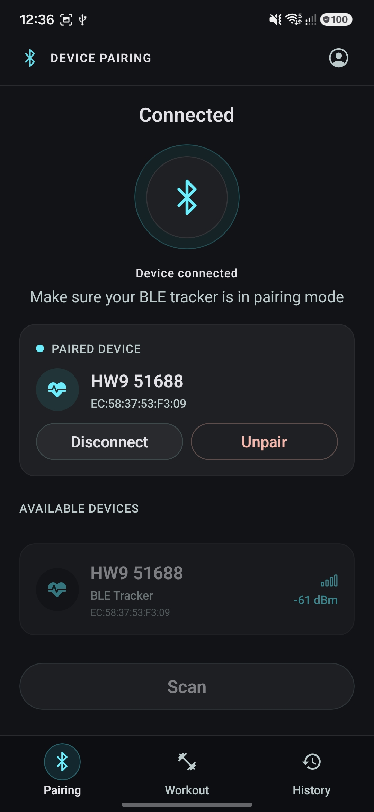
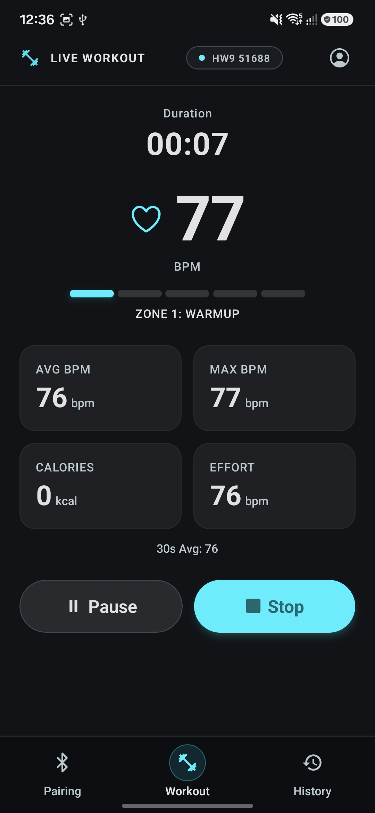
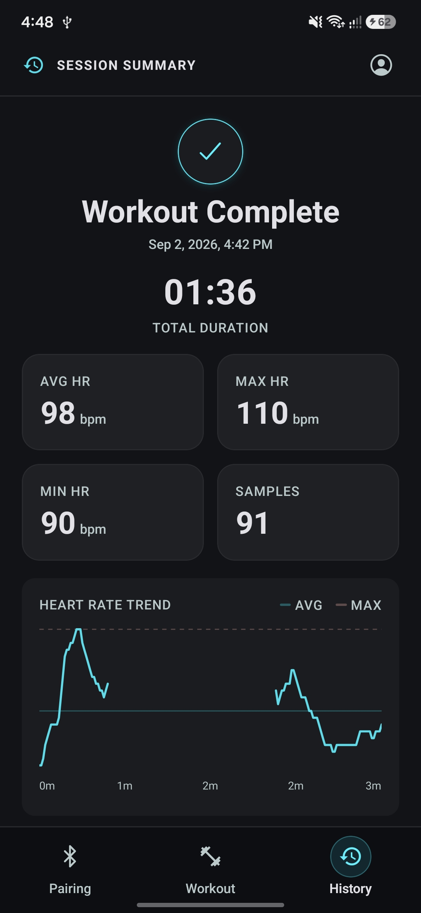
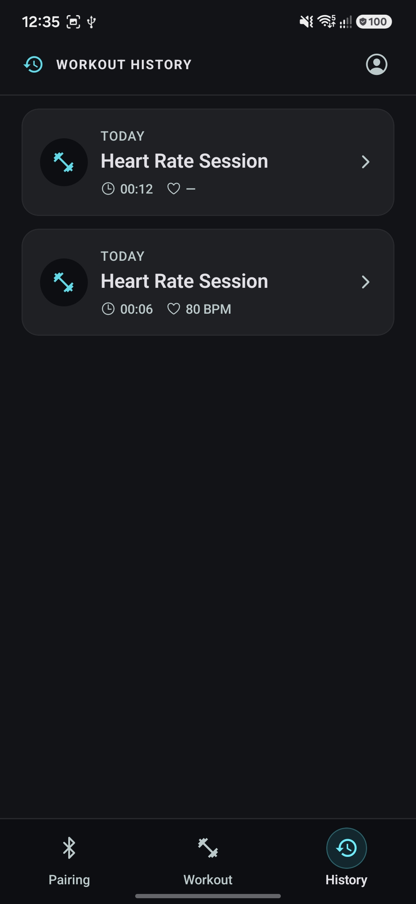
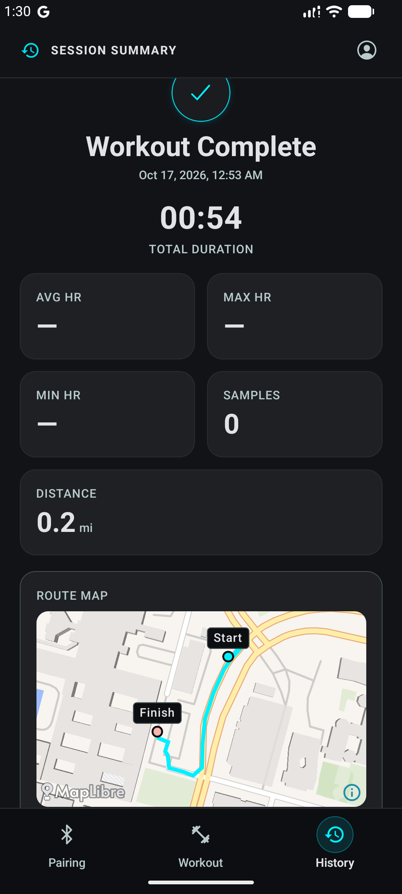

# Fitness Tracker

A React Native / Expo app that pairs with a standard BLE Heart Rate device (GATT service
`0x180D`), records live workout sessions, and writes them back to Health Connect.

Android only - see [`CLAUDE.md`](./CLAUDE.md) for the full set of project decisions and
non-negotiables (no iOS, no custom backend, Expo SDK 56, dev client required).

_Note: This project is updated regularly, and this README is kept up-to-date alongside
it. Anything described below as "not yet implemented" is scoped for a later milestone._

## Screenshots

|                                                  Device Pairing                                                   |                                                  Active Workout                                                   |                                                   Session Summary                                                    |                                               History                                               |
| :---------------------------------------------------------------------------------------------------------------: | :---------------------------------------------------------------------------------------------------------------: | :------------------------------------------------------------------------------------------------------------------: | :-------------------------------------------------------------------------------------------------: |
| &nbsp;&nbsp;&nbsp;&nbsp; | &nbsp;&nbsp;&nbsp;&nbsp; | &nbsp;&nbsp;&nbsp;&nbsp; | &nbsp;&nbsp;&nbsp;&nbsp; |
|                                                   **Route Map**                                                   |                                                                                                                   |                                                                                                                      |                                                                                                     |
|      &nbsp;&nbsp;&nbsp;&nbsp;      |                                                                                                                   |                                                                                                                      |                                                                                                     |

## Features

Scope is tracked in [`docs/specs.md`](./docs/specs.md), milestone by milestone.

### Milestone 1 - Core BLE + local tracking ✓ Done

- ✓ **BLE permission handling**: Android 12+ runtime permission gate (`BLUETOOTH_SCAN`, `BLUETOOTH_CONNECT`, `ACCESS_FINE_LOCATION`) with retry and system settings recovery.
- ✓ **Device pairing screen**: Scans and connects to nearby BLE Heart Rate (`0x180D`) devices ordered by signal strength.
- ✓ **Explicit connection state machine**: Stable `idle | scanning | connecting | connected | disconnected | error` flow across drops and failed scans.
- ✓ **Auto-reconnect**: Persists the last-paired device ID and reconnects automatically on launch.
- ✓ **Live workout screen**: Live BPM readout, HR zone bar, rolling average BPM, elapsed timer (`Start / Pause / Resume / Stop`), and non-disruptive mid-session reconnects.
- ✓ **Session summary screen**: Shows total duration, distance, and avg/max/min HR immediately on Stop, saving locally first.
- ✓ **History screen**: Lists past sessions newest-first with tap-through navigation to the session summary.
- ✓ **Local persistence**: Namespaced MMKV key-value storage and SQLite time-series storage; all stats work with zero HR samples.

### Milestone 2 - Platform integration, sync, polish (in progress)

- ✓ **i18n**: English and Japanese translations with a Settings language switcher.
- ✓ **Accessibility**: Semantic roles, labels, hints, and states across screens and components.
- ✓ **Crash reporting**: Firebase Crashlytics integration (`src/services/crashService.ts`) and a root error boundary.
- ✓ **Health Connect write-back**: Writes completed `ExerciseSession` and `HeartRate` records to Android Health Connect:
  - ✓ **Availability guard**: Checks status (`available | needs-install | needs-update | unsupported`) and links to the Play Store when needed.
  - ✓ **Session write-back**: Syncs after local save with status badges and manual retry on the summary screen.
  - ✓ **Retry queue**: Bounded, backoff-based automatic retries on foreground and manual retry from Settings.
- ✓ **Units toggle (metric/imperial)**: Persisted unit preference with locale-aware formatting (`src/services/units/`) for distance, weight, elevation, speed, and pace.
- ✓ **Offline/online indicator**: Root NetInfo listener driving an offline banner on Settings and gating sign-in attempts.
- ✓ **Google login (Firebase Auth)**: Optional Google Sign-In and anonymous guest mode in Settings; all workout flows work signed out.
- ✓ **Firestore cloud sync**: Syncs `units` and `language` via `users/{uid}` for Google-signed-in users (offline-first via MMKV, guests excluded).
- ✓ **Heart-rate trend chart**: Custom `react-native-svg` line chart on the session summary with avg/max reference lines, pause/disconnect gaps, and LTTB downsampling.
- ✓ **Tablet and landscape layouts**: Responsive layouts (`useResponsiveLayout`) with a two-pane History view at 720dp+ and rotation-safe active workouts.
- **Graceful web/tablet degradation**: Fallback UI where live BLE pairing is unavailable. _Not yet implemented._

### Milestone 3 / stretch (in progress)

- ✓ **GPS route tracking + map redraw**: Foreground GPS route sampling, live distance tracking, and session summary route polyline map with Start/Finish markers.
- **Strava API integration**: Import and export activities via OAuth.
- **Step counting**: Read aggregated step data via Health Connect.
- **Calorie estimation**: MET-based calculation with HR-adjusted correction.
- **Weight tracking**: User weight profile and history chart synced with Health Connect.
- ✓ **GPS-derived altitude profile**: Elevation line chart over distance reusing `LineChart`.

## Tech Stack

Per [`docs/specs.md`](./docs/specs.md) and [`package.json`](./package.json).

- **Framework**: [React Native](https://reactnative.dev) 0.85, [Expo](https://expo.dev/) SDK 56, React 19 (New Architecture).
- **Routing**: [Expo Router](https://docs.expo.dev/router/introduction/) (file-based routing).
- **BLE**: [`react-native-ble-plx`](https://github.com/Polidea/react-native-ble-plx) for scanning, connecting, and Heart Rate (`0x180D`) notifications.
- **State Management**: [Zustand](https://zustand-demo.pmnd.rs/) for workout session state and settings.
- **Storage**: [MMKV](https://github.com/mrousavy/react-native-mmkv) (`react-native-mmkv`) for key-value data and `expo-sqlite` for session summaries, HR samples, and GPS route time-series.
- **Location & Maps**: `expo-location` for foreground GPS route sampling and [`@maplibre/maplibre-react-native`](https://maplibre.org/maplibre-react-native/) (OpenFreeMap tiles) for route polyline rendering.
- **Keep Awake**: `expo-keep-awake` to prevent screen sleep during active workouts.
- **Animation & Gestures**: [React Native Reanimated](https://docs.swmansion.com/react-native-reanimated/), [Gesture Handler](https://docs.swmansion.com/react-native-gesture-handler/), Screens, and Safe Area Context.
- **Health Connect**: [`react-native-health-connect`](https://github.com/matinzd/react-native-health-connect) with `expo-build-properties` and `plugins/withHealthConnectManifest.js`.
- **i18n & Units**: [`i18n-js`](https://github.com/fnando/i18n-js) and `expo-localization` for EN/JA translations, locale detection, and unit conversion (`src/services/units/`).
- **Auth & Cloud Sync**: `@react-native-firebase/auth`, [`@react-native-google-signin/google-signin`](https://react-native-google-signin.github.io/), and `@react-native-firebase/firestore` (`users/{uid}` preference sync).
- **Crash Reporting**: `@react-native-firebase/app` + `@react-native-firebase/crashlytics`.
- **Connectivity**: [`@react-native-community/netinfo`](https://github.com/react-native-netinfo/react-native-netinfo) for online/offline detection.
- **Charts**: [`react-native-svg`](https://github.com/software-mansion/react-native-svg) primitives powering a custom `LineChart` component (`src/services/chart/`).
- **Icons & Fonts**: `@expo/vector-icons` (Ionicons) and `expo-font` (custom fonts pending).
- **Builds & Updates**: EAS Build (`eas.json`), `expo-updates` for OTA delivery, and fingerprint-gated EAS Workflows (`.eas/workflows/`).
- **Testing**: [`jest-expo`](https://docs.expo.dev/develop/unit-testing/) + [`@testing-library/react-native`](https://callstack.github.io/react-native-testing-library/) for unit/component tests; Maestro planned for E2E.
- **Linting & Code Quality**: [Oxlint](https://oxc.rs/docs/guide/usage/linter.html), Prettier, Husky, and lint-staged, enforced in CI (`.github/workflows/ci.yml`).

Deferred to Milestone 3 / stretch:

- `expo-secure-store` + `expo-auth-session` for Strava OAuth.
- `expo-task-manager` for background route sampling.
- TanStack Query (if Strava REST API is integrated).

## Getting Started

### Prerequisites

- [Node.js](https://nodejs.org/) and [pnpm](https://pnpm.io/).
- Android Studio (emulator) or a physical Android device with USB debugging enabled.
- **Custom dev client required**: Native modules do not run in Expo Go; build with `expo run:android`.

### Installation

```bash
pnpm install
```

### Google Sign-In (Firebase)

Sign-in is optional (all workout flows work signed out). To enable the Settings Account section:

1. Enable **Google** sign-in in the [Firebase console](https://console.firebase.google.com/).
2. Register debug and release SHA-1 and SHA-256 fingerprints on Android app `com.arcanys.yansonalvin.fitnesstracker`:
   - Debug: `keytool -list -v -keystore android/app/debug.keystore -alias androiddebugkey -storepass android`
   - Release: `npx eas credentials --platform android`
3. Replace `google-services.json` in the repo root with the updated download.
4. Set `extra.googleWebClientId` in `app.json` to the **Web** client ID (`oauth_client` with `"client_type": 3`, not `client_type: 1`).
5. Rebuild the native client (`pnpm android`).

### Firestore rules

Preference sync requires a Cloud Firestore database in **Native mode**. Deploy [`firestore.rules`](./firestore.rules) (scopes `users/{uid}` to non-anonymous owners and restricts fields to `units`, `language`, and `updatedAt`):

```bash
npx firebase deploy --only firestore:rules
```

### Running the App

```bash
pnpm android   # builds and installs the native dev client
pnpm start     # starts Metro for the dev client
```

_Note: `pnpm ios` and `pnpm web` are leftover template scripts; Android is the only supported target._

## Available Scripts

- **`pnpm start`**: Starts Metro for the dev client.
- **`pnpm android`**: Builds and runs the app on an Android device/emulator
  (`expo run:android`).
- **`pnpm test`**: Runs the test suite with `jest-expo`.
- **`pnpm lint`**: Lints the codebase with Oxlint.
- **`pnpm format`**: Formats the code with Prettier.
- **`pnpm typecheck`**: Runs TypeScript type checking (`tsc --noEmit`).
